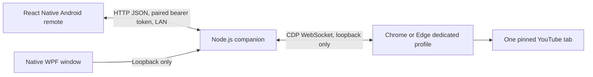

# Glide YT: system design

Status: standalone Android APK built and verified; Windows/live YouTube integration checks pass. Actual phone validation is tracked in validation.md.

## Scope

Search YouTube, choose another video, play, pause, and optionally seek/adjust volume from Android over the same local Wi-Fi. All selections reuse one pinned YouTube tab. Local laptop actions are reflected on the phone. Full automatic handoff between the official Android YouTube app and Windows is outside this version.

## Components

- `packages/core`: command validation, address validation, time formatting, and HTTP client. Plain CommonJS JavaScript works in both Metro and Node. No duplicated protocol definitions.
- `apps/companion`: Node built-in HTTP server, authentication, CDP transport, browser lifecycle, and isolated YouTube page adapter. No npm runtime dependencies, Electron, Express, Puppeteer, or bundled browser.
- `apps/android`: bare React Native/Hermes, React, and safe-area-context. Native Android Keystore module persists the paired token. No navigation, state-management, HTTP, icon, or analytics packages.

## Browser control

Launch an installed Chrome/Edge with a separate persistent profile and a loopback debugging port. Chrome 136+ requires a non-default profile for debugging. Never attach to or copy the user's normal browser profile or cookies. A designated YouTube target is pinned; closing it produces a recoverable error rather than selecting a different tab. Explicitly reopening the browser is a local action. Navigation uses `Page.navigate` on that same target, never `Target.createTarget` or a remote `/json/new` request.

Page actions use a fixed adapter via `Runtime.evaluate`; phone requests never supply JavaScript or arbitrary URLs. Search fetches a YouTube results document in the existing page context and extracts public video metadata without changing the playing page. A bounded cache reduces duplicate requests. This is a website integration, not a supported YouTube search API; result formats can change and consent/challenge pages are reported explicitly. All such parsing lives in one adapter. An official Data API adapter can replace it later if a key/quota is acceptable. No media files are downloaded or proxied.

The browser owns login, ads, recommendations, and playback. A person signs in in the browser. Account access and playback must be tested with the real account; browser automation may affect sign-in. OAuth tokens do not sign a webpage into YouTube. No sign-in bypass or cookie transfer is implemented.

## Pairing and local access

The Windows app displays a rotating, six-digit, five-minute pairing code and private IPv4 addresses. Failed attempts are rate-limited globally and per address. Pairing mints a 256-bit random device token. Only its SHA-256 hash is stored on Windows; Android encrypts its copy using Android Keystore. Tokens persist across companion restarts. Paired devices can be revoked from the Windows app or by the phone. Codes never appear on unauthenticated LAN endpoints. Command bodies are bounded and allowlisted. Requests with browser Origin headers must match the loopback origin; no CORS is offered. The CDP port is never exposed to the LAN by our launcher.

HTTP is deliberately limited to private IPv4 networks in this personal-use prototype. Pairing and commands are unencrypted on the LAN; a bearer token does not protect against traffic interception. Use a trusted home Wi-Fi only. TLS with certificate pinning is a future upgrade if shared/untrusted networks are needed. No cloud service, account registration, internet tunnel, UPnP, or port forwarding. Internet access is still required for YouTube itself. Local setup can explicitly request UAC approval for a firewall rule restricted to the Node executable, companion TCP port, LocalSubnet, and Private profile. No rules change automatically on startup, and the debugging port is not opened.

`/install` and `/download/android.apk` serve a static phone-install page and one fixed built APK over the private LAN without authentication. They expose no pairing code or local administrative secret. Other API and setup authorization requirements remain unchanged.

## API v1

| Method | Endpoint | Purpose |
| --- | --- | --- |
| GET | `/v1/health` | Protocol/version check only |
| POST | `/v1/pair` | `{code,name}` → token and laptop name |
| GET | `/v1/state` | Current video/state, or browser connection error |
| POST | `/v1/search` | `{query}` → normalized video results |
| POST | `/v1/command` | `play`, `pause`, `select(videoId)`, `seek(seconds)`, `volume(level)` |
| POST | `/v1/unpair` | Revoke calling device |

All except health/pair require bearer authentication. HTTP 401 means re-pair, 429 means rate limit, 400 means invalid input, and 503 means browser/YouTube not ready. Errors are safe user-facing messages; tokens and page content are never logged. Local administrative routes require a separate unpredictable secret shown only in the local companion credential file.

## Resource use and consistency

A background Node process, the installed browser for playback, and a WPF window while setup is open. No autonomous browser polling: the browser is queried only by the foreground phone or visible Windows window. Foreground Android requests state every two seconds, one request at a time; backgrounding aborts the request and stops polling. Pairing and search are user-triggered. CDP reuses one socket; mutation commands are serialized. State carries observed playback time rather than assuming a remote command succeeded. Search aborts/timeouts are bounded; results/cache are capped. This is single-device playback, not a shared queue or simultaneous streaming system.

## Verification

Node's built-in test runner covers pairing persistence/expiry/revocation, LAN/Origin validation, command validation, HTTP authorization, same-target navigation, CDP failure handling, and YouTube result normalization. A local browser smoke test can exercise the CDP adapter with a synthetic video page without Google login. Manual acceptance: pair actual Android phone; search without interrupting playback; select several videos and confirm one target ID; play/pause both directions; restart companion; background/reopen Android; revoke a device; check consent/login/error states. Measure private bytes/working set on the target machine before making memory claims.
